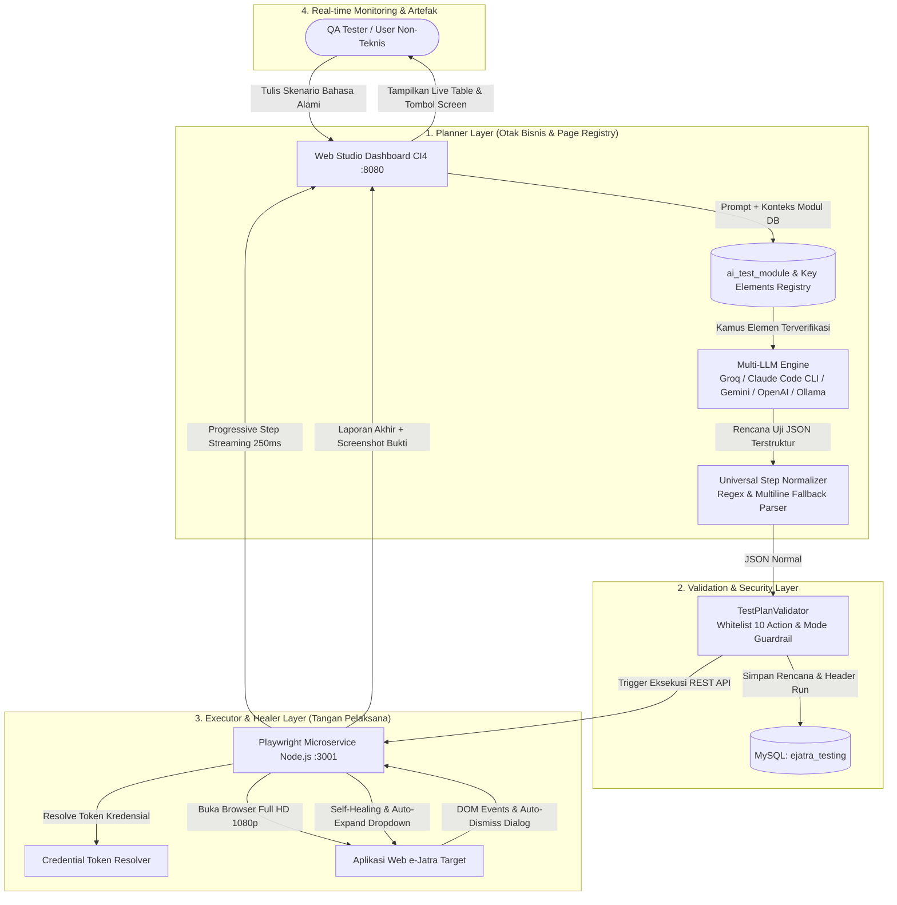

# e-Jatra AI Automation Testing Studio (QA & QC Engine)
> **Product Requirements Document (PRD v3) & Technical Architecture Specification**  
> *Version: 3.0.0 (Enterprise Resilient Edition) | Environment: Local / LAN | Framework: CodeIgniter 4 + Multi-LLM + Playwright*

---

## 📌 1. Executive Summary & Visi Produk v3

**e-Jatra AI Automation Testing Studio v3** adalah platform pengujian otomasi cerdas (*Intelligent Test Automation Platform*) yang dirancang untuk menjembatani **tim non-teknis (QA Manual, Business Analyst, Product Owner)** agar dapat merancang, mengeksekusi, dan memelihara pengujian otomasi browser secara mandiri menggunakan **bahasa Indonesia sehari-hari tanpa perlu menulis kode pemrograman**.

### 🌟 Fondasi Arsitektur v3 (The Trio AI Agents Framework):
Sistem memisahkan secara tegas antara **Perencana Bisnis** (*Planner Layer*) dan **Pelaksana Teknis Browser** (*Executor & Healer Layer*):
1. **Planner Agent (`LlmService.php`)**: Menganalisis niat pengujian pengguna, memetakan ke kamus modul basis data (`ai_test_module`), dan menghasilkan rencana uji JSON terstandarisasi.
2. **Generator & Normalizer (`stepNormalizer.js`)**: Memvalidasi dan menormalisasi sintaks JSON multi-format, alias aksi, dan penanganan fallback secara instan tanpa pemborosan token API.
3. **Executor & Healer Agent (`stepExecutor.js` & `selfHealer.js`)**: Mengeksekusi interaksi browser dengan penanganan otomatis widget khusus (Select2, SweetAlert, native dialog, menu accordion) dan perbaikan selektor mandiri (*Self-Healing*).

---

## 🏗️ 2. Arsitektur Sistem & Diagram Alur Data v3



---

## 🛡️ 3. Perbandingan Masalah v2 vs Solusi Tuntas v3

| Aspek Tantangan | Kondisi di v2 | Solusi Terpasang di v3 |
| :--- | :--- | :--- |
| **Penentuan Selector** | AI berpotensi menebak CSS/XPath yang rapuh (*flaky*) | **Key Elements Registry** di `ai_test_module` + **Bilingual Semantic Locators** + **AI Self-Healing** dinamis di `locatorResolver.js`. |
| **Keamanan Kredensial** | Kredensial ditulis literal di test plan | Didukung **Credential Token** (misal `{{AI_TEST_USER}}` / `{{AI_TEST_PASSWORD}}`) yang di-resolve saat eksekusi. |
| **Reliabilitas JSON AI** | Format JSON dari LLM bisa berubah format | **Universal Step Normalizer (`stepNormalizer.js`)** memproses format array, multiline fallback (`fallback: #id`), dan satuan waktu (`8000ms`, `3x retry`) secara instan tanpa boros token. |
| **Widget Khusus ERP** | Select2, jQuery Datepicker, SweetAlert macet | **Widget Adapter Layer Terintegrasi**: Auto-click Select2 container $\rightarrow$ cari di `.select2-search__field` $\rightarrow$ auto-dismiss SweetAlert popups. |
| **Navigasi Menu Lipat** | Submenu di dalam sidebar tertutup gagal diklik | **Auto-Expand Accordion (`autoExpandTargetParent`)**: Otomatis mendeteksi dan mengeklik menu induk jika submenu tersembunyi. |
| **Toleransi Verifikasi** | `assert_visible` mogok jika ada beda sebutan judul | **Resilient Assertions**: Memvalidasi kontainer halaman / tabel aktif sebagai fallback cerdas (*Self-Healed Assertion*). |
| **Multi-Provider LLM** | Terbatas pada satu vendor API | Mendukung **5 Provider**: Groq API, Claude Code CLI (Langganan Pro Bulanan), Google Gemini, OpenAI, dan Ollama Lokal Offline. |

---

## 🎯 4. Spesifikasi Komponen & Modul Teknis

### A. Planner Layer (`app/Libraries/LlmService.php`)
* **Peran**: Bertindak sebagai **Principal SDET Architect**.
* **Aturan Navigasi Ketat**:
  * Aksi `goto` **hanya diizinkan pada Langkah 1** (`goto: "/"`).
  * Seluruh perpindahan halaman setelah login **wajib menggunakan aksi `click`** (`click: "Dashboard -> Aspal"`) untuk menjaga keutuhan *session* e-Jatra.
* **Multi-Provider Adapter**:
  * **Groq Cloud**: Model `openai/gpt-oss-20b` & `qwen/qwen3.6-27b` (Latensi ultra-cepat < 2 detik).
  * **Claude Code CLI**: Menggunakan langganan bulanan Claude Pro via CLI `claude -p` tanpa biaya API.
  * **Google Gemini**: Model `gemini-2.0-flash`.
  * **OpenAI**: Model `gpt-4o-mini`.
  * **Ollama**: Model `qwen2.5:7b-instruct` (100% lokal offline tanpa internet).

---

### B. Universal Step Normalizer (`test-service/src/utils/stepNormalizer.js`)
Normalizer bertugas membersihkan dan menstandarisasi rencana pengujian dari LLM sebelum dieksekusi oleh Playwright:
* **Parsing Multiline Selector**: Mengonversi `css input[name='username']\nfallback: #username` menjadi target utama dan cadangan.
* **Normalisasi Prefiks**: Memproses `css ...`, `text ...`, `xpath ...`, `id ...`, `name ...` menjadi strategi Playwright yang tepat.
* **Konversi Waktu & Percobaan**: Mengubah `visible 8000ms` menjadi `timeout: 8000 ms`, dan `3x` menjadi `max_attempts: 3`.

---

### C. Executor & Healer Layer (`test-service/src/runner/`)
* **Full HD Viewport (1920x1080)**: Mencegah sidebar e-Jatra terlipat menjadi tampilan mobile.
* **Auto-Dismiss Dialogs & Overlays (`autoDismissOverlays`)**: Menutup otomatis popup SweetAlert/Modal Bootstrap dan menangani native alert browser (`page.on('dialog')`).
* **Dropdown & Select2 Adapter**: Otomatis membuka dropdown `Pilih Unit`, mengetik di kolom pencarian, dan memilih baris unit target.
* **Bilingual Semantic Locators (`locatorResolver.js`)**: Kamus sinonim kata Bahasa Indonesia & Inggris (`Masuk` = `Login`, `Cari` = `Search`/`Filter`, `Unit` = `Kendaraan`/`Alat`).
* **AI Self-Healing (`selfHealer.js`)**: Pemindaian DOM hidup dengan algoritma *Levenshtein similarity* untuk memperbaiki selector yang diubah developer secara otomatis.
* **Artefak Pengujian Visual**: Mengambil bukti foto tangkapan layar penuh pada setiap langkah sukses maupun gagal yang langsung disematkan pada tombol **`[📷 Screen]`**.

---

### D. Web Studio Dashboard (`app/Controllers/AiAutomationTest.php`)
* **Live Execution Monitor**: Polling reaktif 250ms dengan pembaruan status per baris langkah (`PENDING`, `RUNNING`, `PASS`, `FAIL`).
* **Manajemen Antrean & Concurrency**:
  * Mendukung hingga 5 eksekusi paralel.
  * Fitur **`Cancel Run`** dan **`Cancel All`** untuk menghentikan pengujian yang macet secara instan.
  * Auto-timeout pembersihan antrean kedaluwarsa (> 2 menit).

---

## 🗄️ 5. Skema Basis Data (MySQL: `ejatra_testing`)

```sql
-- 1. Modul Bisnis & Registry Elemen Kunci
CREATE TABLE `ai_test_module` (
  `id` INT AUTO_INCREMENT PRIMARY KEY,
  `code` VARCHAR(50) NOT NULL UNIQUE,
  `name` VARCHAR(100) NOT NULL,
  `base_url` VARCHAR(255) NOT NULL,
  `business_flow` TEXT,
  `key_elements` TEXT,
  `status` ENUM('active','inactive') DEFAULT 'active',
  `created_at` DATETIME,
  `updated_at` DATETIME
);

-- 2. Skenario Uji Tersimpan
CREATE TABLE `ai_test_case` (
  `id` INT AUTO_INCREMENT PRIMARY KEY,
  `module_id` INT NOT NULL,
  `title` VARCHAR(255) NOT NULL,
  `prompt_scenario` TEXT NOT NULL,
  `test_plan_json` LONGTEXT NOT NULL,
  `mode` ENUM('read_only','write_test') DEFAULT 'read_only',
  `status` ENUM('draft','active','archived') DEFAULT 'active',
  `created_at` DATETIME,
  `updated_at` DATETIME,
  FOREIGN KEY (`module_id`) REFERENCES `ai_test_module`(`id`)
);

-- 3. Header Riwayat Eksekusi
CREATE TABLE `ai_test_run` (
  `id` INT AUTO_INCREMENT PRIMARY KEY,
  `test_case_id` INT NULL,
  `status` ENUM('QUEUED','RUNNING','PASSED','FAILED','CANCELLED') DEFAULT 'QUEUED',
  `total_steps` INT DEFAULT 0,
  `passed_steps` INT DEFAULT 0,
  `failed_steps` INT DEFAULT 0,
  `skipped_steps` INT DEFAULT 0,
  `total_duration_ms` INT DEFAULT 0,
  `started_at` DATETIME,
  `finished_at` DATETIME,
  `created_at` DATETIME,
  `updated_at` DATETIME
);

-- 4. Rincian Langkah & Artefak
CREATE TABLE `ai_test_run_detail` (
  `id` INT AUTO_INCREMENT PRIMARY KEY,
  `test_run_id` INT NOT NULL,
  `step_no` INT NOT NULL,
  `action` VARCHAR(50) NOT NULL,
  `target_json` TEXT,
  `value` TEXT,
  `expected_result` TEXT,
  `result` ENUM('pending','running','passed','failed','skipped') DEFAULT 'pending',
  `error` TEXT,
  `duration_ms` INT DEFAULT 0,
  `screenshot` VARCHAR(255),
  `dom_snapshot` VARCHAR(255),
  FOREIGN KEY (`test_run_id`) REFERENCES `ai_test_run`(`id`) ON DELETE CASCADE
);
```

---

## 🚀 6. Panduan Menjalankan Sistem (1-Click Launch)

### Persyaratan:
1. PHP 8.1+ (XAMPP Apache & MySQL aktif di port `3306`).
2. Node.js 18+ terinstal di sistem.
3. Playwright browser binaries terpasang (`npx playwright install chromium`).

### Menjalankan Aplikasi:
Cukup klik dua kali file **[`start.bat`](file:///c:/Users/acer/Documents/Projek/qa/start.bat)** di root proyek.
Sistem akan otomatis membuka browser ke alamat:
👉 **`http://localhost:8080/`**

---

## ✍️ 7. Panduan Penulisan Skenario Non-Teknis

### Contoh Skenario Dashboard Aspal (Filter & Generate):
```text
1. Login dengan akun edpraya
2. Buka Dashboard Aspal
3. Pilih unit PT Sarana Maluku Utama
4. Klik tombol Generate
5. Pastikan tabel dashboard muncul dan ambil screenshot bukti
```

### Contoh Skenario Transaksi SPM Aspal (Input Pesanan):
```text
1. Login sebagai edpraya
2. Buka menu SPM Aspal
3. Klik tombol Buat Pesanan
4. Pilih customer PT. Jaya Konstruksi
5. Isi Quantity sebesar 18000 kg
6. Klik tombol Simpan Transaksi
7. Pastikan pesan sukses muncul
```

---

## 📋 8. Whitelist 10 Aksi Pengujian Resmi

| Aksi | Fungsi | Contoh Target | Contoh Nilai |
| :--- | :--- | :--- | :--- |
| **`goto`** | Membuka base URL (Hanya Langkah 1) | `body` | `/` |
| **`fill`** | Mengisi input formulir teks/angka/tanggal | `input[name='username']` | `edpraya` |
| **`click`** | Mengeklik tombol, menu, link, atau tab | `Masuk`, `Dashboard -> Aspal` | `-` |
| **`select`**| Memilih opsi dropdown biasa / Select2 | `Unit`, `Pilih Unit` | `PT Sarana Maluku Utama` |
| **`search`**| Mengisi kotak pencarian & Enter | `input[type='search']` | `SPM-2026` |
| **`wait`**  | Memberi jeda stabilisasi DOM | `-` | `1000` *(ms)* |
| **`assert_visible`** | Memverifikasi elemen/tabel muncul di layar | `PT Sarana Maluku Utama` | `-` |
| **`assert_text`** | Memverifikasi teks notifikasi muncul | `-` | `Berhasil disimpan` |
| **`assert_url`** | Memverifikasi URL browser | `-` | `/dashboard` |
| **`screenshot`** | Mengambil bukti foto tangkapan layar | `body` | `bukti_sukses.png` |

---

*Dokumentasi Resmi e-Jatra Quality Assurance & Quality Control Automation Engineering.*
