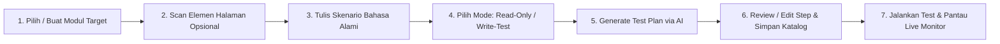

# AI Automation Testing Studio — e-Jatra

Platform pengujian otomasi browser berbasis AI (*Natural Language Test Automation*) yang memungkinkan tim QA, Business Analyst, dan Developer membuat, menjalankan, serta memantau skenario pengujian end-to-end menggunakan instruksi Bahasa Indonesia sehari-hari tanpa perlu menulis kode skrip pengujian secara manual.

Proyek ini dibangun dengan arsitektur dua layanan terintegrasi:
1. **Web Studio & Planner Backend (`CodeIgniter 4` - Port `8080`)**: Antarmuka web untuk manajemen modul, perancangan skenario berbasis Multi-LLM, validasi keamanan *test plan*, antrean eksekusi, serta *Live Execution Monitor*.
2. **Browser Runner & Scanner Microservice (`Node.js + Playwright` - Port `3001`)**: Layanan eksekutor Playwright berarsitektur *Zero-Hardcode* (berbasis konfigurasi) yang dilengkapi *Smart Locator Resolution*, *3-Tier Table Row Matching*, *Widget Adapters* (Select2, DataTables, SweetAlert), *Self-Healing*, dan *Auto Page Scanner*.

---

## ✨ Fitur Utama

- **Natural Language to Test Plan (Multi-LLM)**: Mengubah skenario berbahasa manusia menjadi langkah pengujian JSON terstruktur menggunakan pilihan provider AI: **Groq Cloud**, **Google Gemini**, **OpenAI**, **Claude Code CLI**, atau **Ollama (Local Offline)**.
- **Auto Page Scanner & Key Elements Registry**: Memindai halaman aplikasi target secara otomatis (`pageScanner.js`) untuk memetakan struktur menu navigasi (`MenuInduk > Submenu`), input form, tombol, tabel, dan modal ke dalam kamus elemen modul (`ai_test_module`).
- **Zero-Hardcode & Config-Driven Runner**: Seluruh selektor spesifik aplikasi dipisahkan ke dalam file konfigurasi (`test-service/src/config/app-profile.json`, `field-aliases.json`, `synonyms.json`) sehingga mesin eksekutor tetap generik dan mudah diadaptasi ke aplikasi web lain.
- **3-Tier Exact Table Row Matching**: Pencocokan baris tabel (`<tr>`) dengan 3 tingkat presisi (*Exact Cell Match* $\rightarrow$ *Token Boundary Match* $\rightarrow$ *Substring Fallback*) agar pencarian nomor dokumen seperti `SMA00020260014` tidak salah memilih baris bersufiks seperti `SMA00020260014-A`.
- **Proteksi 2 Lapis Mode `read_only` vs `write_test`**:
  - **Lapis 1 (Pre-Generation)**: Mendeteksi kata kerja mutasi data pada prompt saat mode `read_only` aktif dan memberikan opsi konfirmasi beralih ke `write_test` sebelum memanggil LLM.
  - **Lapis 2 (Pre-Execution Guard)**: Memblokir langkah klik tombol penyimpanan/mutasi (`Simpan`, `Submit`, `Hapus`, `Verifikasi`, `Pecah`, `Realisasi`, `Batalkan`) jika dijalankan pada mode `read_only`, namun tetap mengizinkan aksi baca/filter (`View Data`, `Detail`, `Cari`, `Filter`, `Tutup`).
- **Penanganan Otomatis Widget ERP**: Mendukung interaksi otomatis dengan dropdown **Select2**, tabel **DataTables** (termasuk *portal dropdown menu* / tombol hamburger baris), **Bootstrap Modal**, dan konfirmasi **SweetAlert2**.
- **AI Self-Healing & Bilingual Synonym Locator**: Memperbaiki selektor secara dinamis saat struktur DOM berubah menggunakan algoritma kemiripan teks (*Levenshtein similarity*) dan kamus sinonim Indonesia–Inggris.
- **Live Execution Monitor & Bukti Visual**: Pemantauan langkah demi langkah secara *real-time* (polling progresif), pembatalan eksekusi instan (*Hentikan Run* / *Cancel All*), eksekusi *Batch Run*, serta tangkapan layar (*screenshot*) otomatis pada setiap langkah.

---

## 🛠️ Tech Stack

| Komponen | Teknologi |
| :--- | :--- |
| **Web Backend & Dashboard** | PHP 8.2+ / 8.3, CodeIgniter 4.7.4, Bootstrap 5, Vanilla JS (`qa-studio.js`) |
| **Database** | MySQL / MariaDB (`ejatra_testing`) |
| **Browser Automation Service** | Node.js 18+, Express.js, Playwright (`@playwright/test`) |
| **LLM Providers** | Groq API, Google Gemini API, OpenAI API, Claude CLI, Ollama |
| **Logging & Utilities** | Winston Logger, Axios, Dotenv |

---

## 📂 Struktur Direktori Proyek

```text
qa/
├── app/
│   ├── Config/                  # Konfigurasi rute (Routes.php), database, AiAutomationTest.php
│   ├── Controllers/
│   │   └── AiAutomationTest.php # HTTP Controller utama Web Studio
│   ├── Services/
│   │   ├── AiPlanService.php      # Service pembuatan & manajemen Test Plan
│   │   ├── AiExecutionService.php # Service antrean, dispatch eksekusi & hasil test run
│   │   └── AiScanService.php      # Service pemindaian elemen halaman (Ground Truth)
│   ├── Libraries/
│   │   ├── LlmService.php         # Integrasi Multi-LLM, prompt builder & write-intent detector
│   │   ├── TestPlanValidator.php  # Validasi skema JSON, whitelist aksi & guardrail read_only
│   │   └── TestServiceRunner.php  # HTTP client penghubung CI4 ke microservice Node.js
│   ├── Models/                  # Model database (AiTestModule, AiTestCase, AiTestRun, dll.)
│   └── Views/
│       └── ai_automation_test/  # UI Web Studio (index, partials, modal, live monitor)
├── public/
│   └── assets/
│       ├── css/                 # Styling dashboard QA Studio
│       └── js/qa-studio.js      # Logika frontend Studio, Live Monitor, Scanner, Batch Run
├── test-service/                # Microservice Node.js + Playwright (Port 3001)
│   ├── scripts/
│   │   └── audit-hardcode.js    # Script audit penjaga zero-hardcode pada engine
│   ├── screenshots/             # Direktori penyimpanan bukti screenshot hasil eksekusi
│   └── src/
│       ├── config/
│       │   ├── app-profile.json # Profil selektor & aksi baris tabel aplikasi target
│       │   ├── field-aliases.json# Kamus alias field form
│       │   └── synonyms.json    # Kamus sinonim dwibahasa (ID <-> EN)
│       ├── runner/
│       │   ├── testRunner.js    # Orkestrator siklus hidup browser & eksekusi test run
│       │   ├── stepExecutor.js  # Dispatcher eksekusi per langkah & retry/self-healing
│       │   └── actions/         # Handler modular (click, fill, select, tableRowAction, dll.)
│       ├── scanner/
│       │   └── pageScanner.js   # Auto-scanner elemen halaman & struktur navigasi sidebar
│       ├── utils/
│       │   ├── locatorResolver.js # Mesin resolusi locator bertingkat
│       │   ├── locatorHelpers.js  # Helper teks, sinonim & 3-tier row matcher
│       │   ├── elementScorer.js   # Scoring kandidat elemen interaktif terbaik
│       │   ├── elementDiscovery.js# Heuristic & proximity DOM discovery
│       │   ├── stepNormalizer.js  # Normalisasi output JSON dari berbagai LLM
│       │   └── selfHealer.js      # AI/DOM Self-healing saat selektor utama gagal
│       └── server.js            # Express REST API server (:3001)
├── start.bat                    # Script 1-Click Launcher untuk Windows
└── README.md                    # Dokumentasi proyek
```

---

## ⚙️ Prasyarat & Instalasi

### 1. Prasyarat Sistem
- **PHP 8.2+ / 8.3** (dengan ekstensi `intl`, `mbstring`, `mysqli`, `curl`, `json`) dan **MySQL / MariaDB** (port `3306`).
- **Node.js 18+** dan **npm**.
- Browser Chromium untuk Playwright.

### 2. Konfigurasi Database & Backend (CodeIgniter 4)
1. Buat database MySQL bernama `ejatra_testing` dan impor skema tabel (lihat bagian [Skema Database](#-skema-database)).
2. Salin file `env` menjadi `.env` di direktori root proyek, lalu sesuaikan konfigurasi database dan API Key LLM yang digunakan:
   ```ini
   CI_ENVIRONMENT = development
   app.baseURL = 'http://localhost:8080/'

   database.default.hostname = 127.0.0.1
   database.default.database = ejatra_testing
   database.default.username = root
   database.default.password =
   database.default.DBDriver = MySQLi
   database.default.port = 3306

   # Konfigurasi API Key Provider LLM (isi sesuai provider yang dipakai)
   GROQ_API_KEY = "gsk_..."
   GEMINI_API_KEY = "AIza..."
   OPENAI_API_KEY = "sk-..."
   ```

### 3. Instalasi Microservice Playwright (`test-service`)
Buka terminal di folder `test-service` lalu instal dependensi dan browser Chromium:
```powershell
cd test-service
npm install
npx playwright install chromium
```
Salin/buat file `.env` di dalam `test-service/` jika diperlukan untuk mengatur port atau kredensial uji default (`AI_TEST_USER`, `AI_TEST_PASSWORD`, `PORT=3001`).

---

## 🚀 Cara Menjalankan Aplikasi

### Opsi A: Menggunakan 1-Click Launcher (Windows)
Klik dua kali atau jalankan file [`start.bat`](file:///c:/Users/acer/Documents/Projek/qa/start.bat) dari root proyek:
```powershell
.\start.bat
```
Script ini akan otomatis:
1. Memastikan layanan MySQL aktif di port `3306`.
2. Menjalankan server web CodeIgniter 4 di `http://localhost:8080`.
3. Menjalankan microservice Playwright di `http://localhost:3001`.
4. Membuka halaman **AI Automation Testing Studio** di browser (`http://localhost:8080/ai-automation-test`).

### Opsi B: Menjalankan Secara Manual via Terminal
**Terminal 1 — Web Studio (CodeIgniter 4):**
```powershell
php spark serve --port 8080
```

**Terminal 2 — Playwright Test Service (Node.js):**
```powershell
cd test-service
npm run dev
```

---

## 🔄 Alur Penggunaan (Workflow Studio)



1. **Kelola Modul**: Daftarkan modul aplikasi beserta *Base URL* dan daftar *Key Elements* (atau gunakan fitur **Auto-Scan Halaman** untuk memindai elemen secara otomatis).
2. **Tulis Skenario**: Ketik langkah pengujian dengan bahasa sehari-hari, misalnya:
   ```text
   1. Login dengan akun user_qa
   2. Buka menu Aspal > Input SPB
   3. Cari nomor SPB SMA00020260014
   4. Klik tombol aksi pada baris SMA00020260014 lalu pilih View Data
   5. Pastikan detail SPB tampil dan ambil screenshot
   ```
3. **Pilih Mode Eksekusi**:
   - `Read-Only`: Hanya untuk navigasi, pencarian, filter, dan melihat detail data (aman dari perubahan database).
   - `Write-Test`: Mengizinkan pengisian form transaksi dan klik tombol simpan/ubah/hapus/verifikasi/pecah data.
4. **Generate & Jalankan**: Klik **Generate Plan**, periksa langkah JSON yang dihasilkan pada tab **Test Plan**, lalu klik **Jalankan Test** untuk memantau eksekusi secara langsung pada tab **Live Monitor**.

---

## 📋 Daftar Aksi Pengujian yang Didukung

| Aksi | Fungsi | Contoh Target | Contoh Nilai (`value`) |
| :--- | :--- | :--- | :--- |
| **`goto`** | Membuka halaman URL (Langkah 1) | `body` | `/` atau URL penuh |
| **`fill`** | Mengisi input teks, angka, atau tanggal | `input[name='username']` | `user_qa` |
| **`click`** | Mengeklik tombol, menu sidebar, tab, atau aksi baris tabel | `Masuk`, `Aspal > Input SPB`, `tr:has-text('SMA00020260014') .dropdown-item:has-text('View Data')` | `-` |
| **`check`** | Mencentang checkbox atau radio button | `tr:has-text('SMA00020260014') input[type='checkbox']` | `-` |
| **`select`** | Memilih opsi pada `<select>` native maupun dropdown **Select2** | `Pilih Unit` | `PT Sarana Maluku Utama` |
| **`search`** | Mengisi kolom pencarian tabel dan menekan Enter | `input[type='search']` | `SMA00020260014` |
| **`wait`** | Memberikan jeda tunggu eksplisit (ms) atau menunggu elemen | `-` | `1000` |
| **`assert_visible`** | Memastikan elemen atau teks tampil di layar | `SMA00020260014` | `-` |
| **`assert_text`** | Memastikan teks notifikasi/elemen sesuai ekspektasi | `.swal2-html-container` | `Berhasil disimpan` |
| **`assert_url`** | Memastikan URL halaman saat ini memuat path tertentu | `-` | `/dashboard` |
| **`screenshot`** | Mengambil tangkapan layar penuh sebagai bukti pengujian | `body` | `bukti_pengujian.png` |

---

## 🗄️ Skema Database (`ejatra_testing`)

Proyek menggunakan 4 tabel utama di MySQL:
- **`ai_test_module`**: Menyimpan daftar modul aplikasi target (`code`, `name`, `base_url`, `business_flow`, `key_elements`, `status`).
- **`ai_test_case`**: Menyimpan katalog skenario pengujian (`module_id`, `title`, `prompt_scenario`, `test_plan_json`, `mode`, `status`).
- **`ai_test_run`**: Menyimpan header riwayat eksekusi (`test_case_id`, `status` [`QUEUED`, `RUNNING`, `PASSED`, `FAILED`, `CANCELLED`], statistik langkah, dan durasi).
- **`ai_test_run_detail`**: Menyimpan log eksekusi per langkah (`test_run_id`, `step_no`, `action`, `target_json`, `value`, `result`, `error`, `duration_ms`, `screenshot`).

---

## 🧪 Audit Kualitas Kode (Zero-Hardcode Guard)

Untuk memastikan tidak ada selektor ID/class spesifik aplikasi yang tertulis secara *hardcode* di dalam logika mesin (`src/runner`, `src/utils`, `src/scanner`), jalankan perintah berikut:

```powershell
node test-service/scripts/audit-hardcode.js --check --verbose
```

Target baseline adalah **`0` temuan hardcode**. Seluruh selektor spesifik aplikasi wajib ditempatkan pada [`test-service/src/config/app-profile.json`](file:///c:/Users/acer/Documents/Projek/qa/test-service/src/config/app-profile.json) atau [`test-service/src/config/field-aliases.json`](file:///c:/Users/acer/Documents/Projek/qa/test-service/src/config/field-aliases.json).
